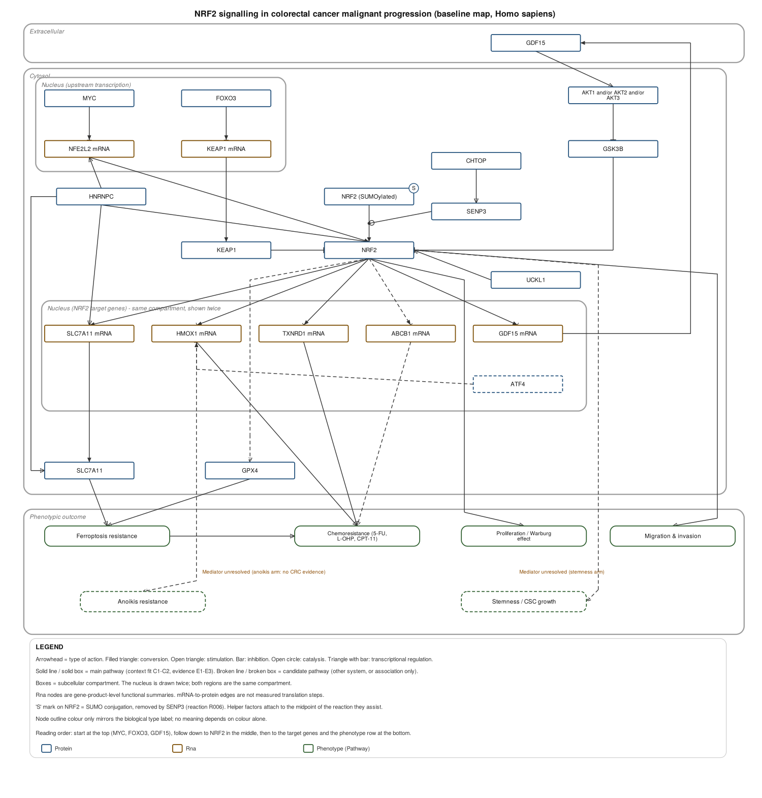

# Worked example: NRF2 in colorectal cancer

A complete run of the template. 28 nodes, 34 reactions (one catalysis connection), 12 papers.



## Input as given

| Field | Value |
|---|---|
| Central factor | NRF2 / NFE2L2 |
| Disease / tissue | Colorectal cancer |
| Species | Human (main pathway); non-human systems as candidate only |
| Phenotypes | chemoresistance; migration/invasion/EMT; proliferation & metabolic reprogramming; ferroptosis resistance & stemness; anoikis resistance |
| Level of detail | Standard |
| Mode | Confirm |

Five phenotypes do not fit comfortably in a standard-detail map, so the approach taken was to keep the shared upstream segment as one trunk and branch to each phenotype through a representative effector axis. That assumption is recorded on the Summary sheet.

Full input in [`inputs/filled-input.md`](inputs/filled-input.md).

## Files

| File | What it is |
|---|---|
| [`outputs/NRF2_CRC_baseline.gpml`](outputs/NRF2_CRC_baseline.gpml) | GPML2013a, editable in PathVisio |
| [`outputs/NRF2_CRC_baseline_evidence.xlsx`](outputs/NRF2_CRC_baseline_evidence.xlsx) | 7-sheet evidence workbook |
| [`outputs/NRF2_CRC_baseline_preview.svg`](outputs/NRF2_CRC_baseline_preview.svg) | Preview, same structural source |
| [`outputs/NRF2_CRC_baseline_preview.png`](outputs/NRF2_CRC_baseline_preview.png) | Raster preview |
| [`build/`](build/) | The scripts that generated and validated all of the above |
| [`VALIDATION.md`](VALIDATION.md) | Validation log, including what failed on the first draft |

Workbook sheets: Summary, RawExtraction, Review, Reactions, CandidateSearch, Entities, Papers.

## What the map says

The upstream half is the more interesting result. Every route found for raising NRF2 level or activity in colorectal cancer is post-transcriptional:

- **GDF15 → PI3K/AKT/GSK3β → NRF2 stabilisation**, with NRF2 transcriptionally driving *GDF15* in return (ChIP + luciferase) — a closed positive feedback loop.
- **CHTOP recruits a SENP3-containing complex** that deSUMOylates NRF2, sustaining HMOX1 expression.
- **UCKL1 stabilises NRF2**, independently of its nucleotide-synthesis activity.
- **HNRNPC** acts twice: shielding *NFE2L2* and *SLC7A11* transcripts from degradation, and binding both proteins directly.
- **c-MYC** sits upstream of NRF2 signalling.

The one negative regulator retrieved with direct promoter-binding evidence is **FOXO3 → KEAP1**.

Downstream, the best-supported arm is NRF2 → SLC7A11 → ferroptosis resistance → chemoresistance, with TXNRD1 and HMOX1 as parallel chemoresistance routes.

## Where it came out dirty

This example is included because the failures are the informative part.

**Two of the five requested phenotypes had no colorectal-cancer evidence at all.**

- *Anoikis resistance*: three differently worded queries returned 0, 0 and 1 hits. The single hit is an ATF4/HO-1 study in fibrosarcoma and lung adenocarcinoma — C3. Drawn as a broken candidate arm with "Mediator unresolved".
- *Stemness*: three queries returned zero. The one related paper describes NRF2/KEAP1 downstream of a drug combination in colospheroids, without perturbing NRF2 or measuring self-renewal. Candidate only.

Both are recorded in CandidateSearch (S003, S004) as searches that returned nothing, not as evidence of absence.

**One paper was retracted.** PMID 30993753 (Nrf2/STAT3, HT-29) is flagged as a Retracted Publication in PubMed. Excluded, with the reason kept in Papers rather than silently dropped.

**One relation has directly conflicting evidence.** For NRF2 → migration & invasion:

- PMID 38452690: shNrf2 and brusatol enhance, tBHQ attenuates, the inhibition of migration and invasion.
- PMID 26733168: NRF2 is barely induced by oxaliplatin; EMT is attributed to a ROS-AKT-Snail axis.

The former was adopted, because it perturbs NRF2 itself in both directions whereas the latter tests a drug stimulus. Both are recorded (Review `R-CONFLICT-1`), and the Migration & invasion node carries a comment pointing there.

**Three relations were downgraded to candidate.** NRF2 → GPX4 is asserted as direct transcriptional control by a review, but no retrieved primary paper demonstrates it in colorectal cancer — reviews cannot be the sole basis for a relation, so it is E4 and broken, with "Mediator unresolved". NRF2 → ABCB1 and ABCB1 → chemoresistance are association only, since MDR1 was the engineered driver in the source model; kept rather than deleted because the resistance phenotype itself is NRF2-dependent.

**One non-monotonic relation was kept out of the figure.** Both restoring *and* further depleting CHTOP resensitise 5-FU-resistant cells. That cannot be drawn as a single arrow, so only the deSUMOylation mechanism is drawn and the phenotype relation is recorded in Review (`RV13`).

**One mechanism was redrawn after review.** The first draft attached both SENP3 and CHTOP to the same reaction Anchor. The source describes CHTOP as recruiting the SENP3-containing 5FMC complex, so the final map makes CHTOP → SENP3 its own complex-assembly edge (R034) with only SENP3 as catalysis.

## Unresolved

- Anoikis resistance in colorectal cancer — no evidence retrieved.
- Stemness — no paper perturbing NRF2 and measuring self-renewal retrieved.
- The ubiquitin ligase downstream of GSK3β (β-TrCP or other) — not drawn.
- The mechanism of NRF2 → GPX4.

## Important caveat

**All 12 papers were read as PubMed abstracts only. No figure panel was opened.** Every observation row is marked `confirm = abstract`, `figure = not checked`.

Before this map is used for anything load-bearing, the four relations graded E1 should be checked against the original figures:

- FOXO3 binding the KEAP1 promoter
- NRF2 → GDF15 (ChIP / luciferase)
- HNRNPC direct interaction with NRF2
- HNRNPC direct interaction with SLC7A11

## Rebuilding

```bash
cd build
python3 build_gpml.py      # writes NRF2_CRC_baseline.gpml
python3 build_xlsx.py      # writes NRF2_CRC_baseline_evidence.xlsx
python3 build_svg.py       # writes NRF2_CRC_baseline_preview.svg
python3 validate.py        # runs every check
xmllint --noout --schema GPML2013a.xsd NRF2_CRC_baseline.gpml
```

`model.py` holds the figure structure (nodes, reactions, waypoints, compartments). `evidence.py` holds the observation records and search log. GPML, workbook and SVG are all generated from those two files, which is what keeps the IDs consistent.

Requires `openpyxl` and `lxml`; `cairosvg` for the PNG. `validate.py` fetches `GPML2013a.xsd` if it is not already present.

## Sources

All literature retrieved from PubMed.

| ID | Paper | DOI |
|---|---|---|
| P001 | NRF2 as a ferroptosis gatekeeper in colorectal cancer (review; skeleton only) | [10.1007/s00210-025-04324-3](https://doi.org/10.1007/s00210-025-04324-3) |
| P002 | HNRNPC reprograms cancer metabolism to drive acquired chemoresistance | [10.1186/s12964-025-02577-2](https://doi.org/10.1186/s12964-025-02577-2) |
| P003 | FoxO3 reverses 5-fluorouracil resistance via the Nrf2/TR1 pathway | [10.1016/j.canlet.2019.11.042](https://doi.org/10.1016/j.canlet.2019.11.042) |
| P004 | CHTOP regulates the NRF2/HO-1 axis to modulate chemoresistance | [10.1016/j.redox.2026.104353](https://doi.org/10.1016/j.redox.2026.104353) |
| P005 | GDF15 induces chemoresistance to oxaliplatin via a feedback loop with Nrf2 | [10.1007/s13402-024-00918-w](https://doi.org/10.1007/s13402-024-00918-w) |
| P006 | Non-canonical role of UCKL1 on ferroptosis defence | [10.1016/j.ebiom.2023.104650](https://doi.org/10.1016/j.ebiom.2023.104650) |
| P007 | Arenobufagin inhibits lung metastasis by targeting the c-MYC/Nrf2 axis | [10.1016/j.phymed.2024.155391](https://doi.org/10.1016/j.phymed.2024.155391) |
| P008 | Iron regulates the Warburg effect and ferroptosis | [10.3389/fonc.2021.614778](https://doi.org/10.3389/fonc.2021.614778) |
| P009 | Upregulation of NOX-2 and Nrf-2 promotes 5-FU resistance in HCT-116 | [10.1134/S0006297921030044](https://doi.org/10.1134/S0006297921030044) |
| P010 | ATF4-dependent induction of HO-1 prevents anoikis (candidate; non-CRC) | [10.1172/JCI78031](https://doi.org/10.1172/JCI78031) |
| P011 | Targeting mitochondrial ribosomal protein expression (candidate) | [10.1016/j.canlet.2025.217647](https://doi.org/10.1016/j.canlet.2025.217647) |
| P012 | Triptonide induces ferroptosis via the SLC7A11/GPX4 axis | [10.1007/s10142-024-01402-2](https://doi.org/10.1007/s10142-024-01402-2) |

Two further papers — one excluded as retracted (PMID 30993753), one held back as conflicting context (PMID 26733168) — are recorded in the Papers sheet.
